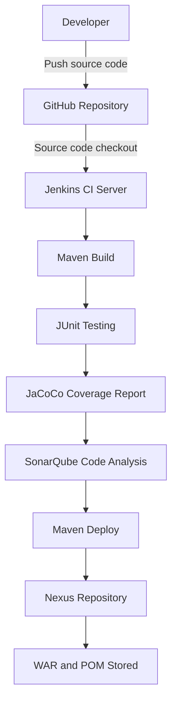
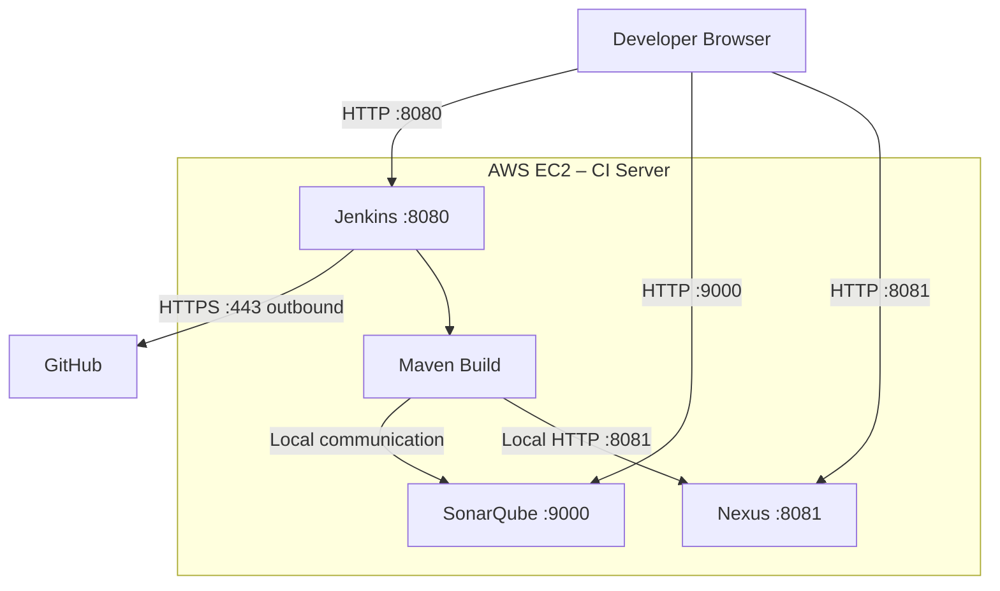
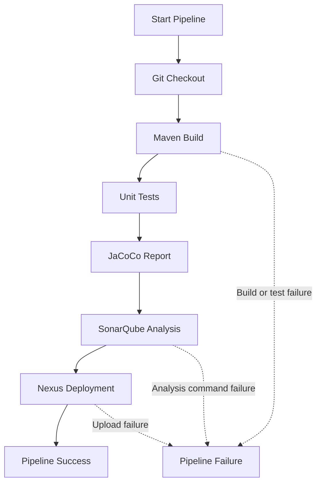
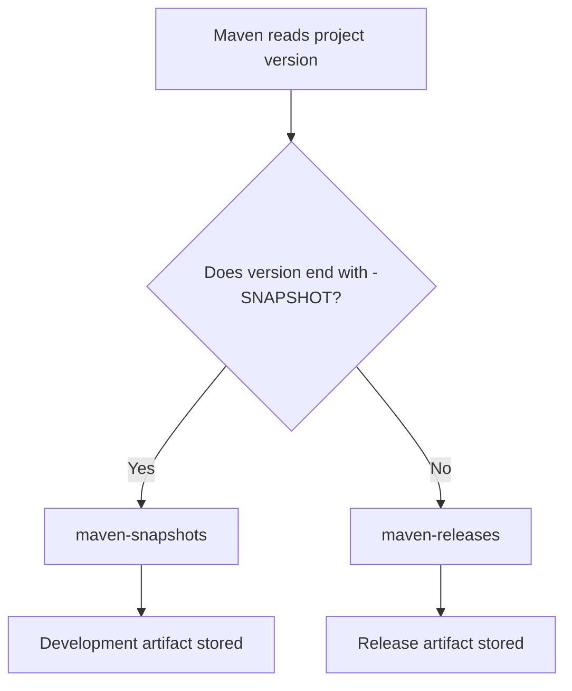

# Docker Using Jenkins – CI Pipeline Project

## 1. Project Overview

In this project, we are learning how a DevOps Engineer builds an application and automatically checks its quality before storing the application package in a repository.

We are using the following tools:

| Tool | Purpose |
|---|---|
| Git | Version control |
| GitHub | Stores source code |
| Jenkins | Automates the CI pipeline |
| Java 21 | Compiles and runs Java applications |
| Maven 3.10.1 | Builds, tests, and packages the application |
| JUnit 5 | Tests Java application code |
| Mockito | Creates fake objects for unit testing |
| JaCoCo | Measures code test coverage |
| SonarQube | Checks code quality |
| Nexus Repository | Stores generated application packages |
| AWS EC2 | Provides the Linux server for our tools |

### What are we building?

We have a Java web application.

Maven converts this application into a WAR file.

Jenkins automatically performs these activities:

1. Gets the source code from GitHub.
2. Builds the application using Maven.
3. Runs unit tests.
4. Generates code coverage information.
5. Sends code analysis to SonarQube.
6. Uploads the generated application package to Nexus.

## 2. Overall CI Architecture

The following diagram shows how all our tools work together.



### Simple explanation

- Developer writes application code.
- GitHub stores the source code.
- Jenkins gets the code and controls the pipeline.
- Maven builds the application.
- JUnit tests the application.
- JaCoCo generates coverage information.
- SonarQube analyzes the code.
- Nexus stores the generated WAR and POM files.

**Important:** This is our CI pipeline. We have not yet added the separate CD server or Docker deployment stage to this Jenkinsfile.

## 3. Our AWS EC2 Environment

We installed our CI tools on an Ubuntu EC2 instance.

### Server information

| Component | Configuration |
|---|---|
| Operating System | Ubuntu |
| Java | OpenJDK 21 |
| Jenkins | 2.580.2 |
| Maven | 3.10.1 |
| Docker | Installed |
| SonarQube | Community Edition |
| Nexus | 3.98.3-01 |

### Application URLs

| Tool | URL |
|---|---|
| Jenkins | http://3.26.68.190:8080/ |
| SonarQube | http://3.26.68.190:9000 |
| Nexus | http://3.26.68.190:8081 |

These are the public IP-based URLs used in our lab. If the EC2 public IP changes, update the URLs accordingly.

## 4. Network Traffic Flow – How Does Communication Work?

This is one of the most important concepts in a real DevOps environment.

Our tools need to communicate with each other.

The following diagram explains how traffic travels.



### 4.1 Developer to Jenkins

The developer opens the Jenkins URL:

```text
http://3.26.68.190:8080/
```

Traffic flow:

```text
Developer Browser
       |
       | HTTP port 8080
       v
AWS Security Group
       |
       v
Jenkins EC2 Server
       |
       v
Jenkins Dashboard
```

Port 8080 is the Jenkins web interface in our setup.

### 4.2 Jenkins to GitHub

Jenkins needs to download the application source code.

Traffic flow:

```text
Jenkins EC2
     |
     | Outbound HTTPS port 443
     v
GitHub
     |
     | Source code
     v
Jenkins Workspace
```

GitHub communication normally uses HTTPS on port 443.

The source code is checked out into the Jenkins workspace.

### 4.3 Jenkins to Maven

Maven is configured in Jenkins Global Tool Configuration.

Jenkins executes Maven commands on its build node.

```text
Jenkins
   |
   v
Maven 3.10.1
   |
   v
pom.xml
   |
   v
Build Application
```

Maven compiles our Java code, executes tests and generates the WAR file.

### 4.4 Maven to SonarQube

Our Jenkins and SonarQube services are running on the same EC2 server.

The pipeline uses:

```groovy
withSonarQubeEnv('SonarQube-Server')
```

Our configured SonarQube URL is:

```text
http://localhost:9000
```

Traffic flow:

```text
Jenkins EC2
     |
     v
Maven SonarQube Scanner
     |
     | HTTP port 9000
     v
SonarQube
     |
     v
Code Analysis Results
```

Because both services are on the same EC2 instance, `localhost` refers to that same server.

The developer can open SonarQube through the public IP and port 9000.

### 4.5 Maven to Nexus

Our Nexus server is also installed on the same EC2 instance.

Maven uploads the application package to:

```text
http://3.26.68.190:8081/repository/
```

Traffic flow:

```text
Jenkins EC2
     |
     v
Maven Deploy
     |
     | HTTP port 8081
     v
Nexus Repository
     |
     v
WAR and POM Stored
```

In our Jenkins deployment stage, the Nexus URL uses the EC2 public IP. Since Nexus is on the same server, localhost could also be used in the repository URL.

### Important: What is inbound and outbound traffic?

**Inbound traffic:** Traffic coming into our EC2 server.

Examples:
- Developer accessing Jenkins.
- Developer accessing SonarQube.
- Developer accessing Nexus.

**Outbound traffic:** Traffic leaving our EC2 server.

Examples:
- Jenkins connecting to GitHub.
- Maven downloading dependencies from Maven Central or Nexus.
- Jenkins communicating with external services.

## 5. AWS Security Group Configuration

A Security Group works like a virtual firewall for our EC2 instance.

It controls which network traffic is allowed to reach the server.

### Ports used in our project

| Port | Service | Purpose |
|---|---|---|
| 8080 | Jenkins | Jenkins dashboard |
| 9000 | SonarQube | Code analysis dashboard |
| 8081 | Nexus | Artifact repository |
| 443 | HTTPS | Outbound connections to GitHub and other services |

The first three are inbound service ports in our setup.

Port 443 is needed for outbound HTTPS communication. Security Groups allow outbound traffic according to their outbound rules.

### Recommended lab configuration

| Type | Port | Source |
|---|---:|---|
| Custom TCP | 8080 | Your public IP |
| Custom TCP | 9000 | Your public IP |
| Custom TCP | 8081 | Your public IP |

Use your own public IP instead of allowing everyone.

**Security note:** Do not expose Jenkins, SonarQube, or Nexus administration interfaces publicly in a production environment. Use private networking, VPN, access restrictions and HTTPS where appropriate.

## 6. Pipeline Execution Flow

This diagram shows the order in which Jenkins executes our stages.



### Simple explanation

1. Jenkins starts the pipeline.
2. Source code is available in the Jenkins workspace.
3. Maven builds the project.
4. JUnit runs the tests.
5. JaCoCo generates the coverage report.
6. SonarQube analyzes the code.
7. Maven uploads the artifacts to Nexus.
8. Jenkins displays the final result.

A failed stage normally stops the later stages from executing.

## 7. GitHub Repository and Project Structure

Our GitHub repository:

https://github.com/Ramana175/Docker

Project structure:

```text
Docker/
│
└── docker-using-jenkins/
    │
    ├── Jenkinsfile
    │
    └── tomcat-web-application/
        │
        ├── pom.xml
        │
        └── src/
            │
            ├── main/
            │   │
            │   ├── java/
            │   │   └── com/
            │   │       └── example/
            │   │           └── HelloServlet.java
            │   │
            │   └── webapp/
            │       └── index.html
            │
            └── test/
                │
                └── java/
                    └── com/
                        └── example/
                            └── HelloServletTest.java
```

### Explanation of folders

- `Jenkinsfile`: Instructions for Jenkins.
- `pom.xml`: Maven project configuration.
- `src/main/java`: Actual Java application code.
- `src/main/webapp`: HTML and web application files.
- `src/test/java`: Test code.

**Remember:**

- `src/main/java` = application code.
- `src/test/java` = testing code.

Do not put JUnit or Mockito test classes inside `src/main/java`.

## 8. Java Application

Our application file is `HelloServlet.java`.

```java
package com.example;

import java.io.IOException;

import jakarta.servlet.ServletException;
import jakarta.servlet.annotation.WebServlet;
import jakarta.servlet.http.HttpServlet;
import jakarta.servlet.http.HttpServletRequest;
import jakarta.servlet.http.HttpServletResponse;

@WebServlet("/hello")
public class HelloServlet extends HttpServlet {

    @Override
    protected void doGet(HttpServletRequest request,
                         HttpServletResponse response)
            throws ServletException, IOException {

        response.setContentType("text/html");

        try {
            response.getWriter().println(
                "<h1>Hello from Docker Using Jenkins!</h1>"
            );
        } catch (IOException e) {
            getServletContext().log("Unable to write response", e);
            response.setStatus(HttpServletResponse.SC_INTERNAL_SERVER_ERROR);
        }
    }
}
```

### Simple explanation

- `HttpServlet` allows our Java class to handle web requests.
- `@WebServlet("/hello")` creates the `/hello` URL mapping.
- `doGet()` handles HTTP GET requests.
- `setContentType()` tells the browser that the response contains HTML.
- `getWriter().println()` sends the message to the browser.
- If writing the response fails, the application logs the error and returns HTTP 500.

## 9. Understanding the pom.xml File

`pom.xml` stands for Project Object Model.

It is the main configuration file used by Maven.

Maven reads this file to understand:

- Project name and version.
- Java version.
- Dependencies.
- Plugins.
- Build configuration.
- Where to upload the generated application package.

### Our complete pom.xml

```xml
<?xml version="1.0" encoding="UTF-8"?>
<project xmlns="http://maven.apache.org/POM/4.0.0"
         xmlns:xsi="http://www.w3.org/2001/XMLSchema-instance"
         xsi:schemaLocation="http://maven.apache.org/POM/4.0.0
         https://maven.apache.org/xsd/maven-4.0.0.xsd">

    <modelVersion>4.0.0</modelVersion>

    <groupId>com.example</groupId>
    <artifactId>tomcat-web-application</artifactId>
    <version>1.0.1-SNAPSHOT</version>
    <packaging>war</packaging>

    <properties>
        <maven.compiler.release>21</maven.compiler.release>
        <project.build.sourceEncoding>UTF-8</project.build.sourceEncoding>

        <sonar.coverage.jacoco.xmlReportPaths>
            ${project.build.directory}/site/jacoco/jacoco.xml
        </sonar.coverage.jacoco.xmlReportPaths>
    </properties>

    <distributionManagement>

        <repository>
            <id>nexus-releases</id>
            <name>Nexus Release Repository</name>
            <url>http://3.26.68.190:8081/repository/maven-releases/</url>
        </repository>

        <snapshotRepository>
            <id>nexus-snapshots</id>
            <name>Nexus Snapshot Repository</name>
            <url>http://3.26.68.190:8081/repository/maven-snapshots/</url>
        </snapshotRepository>

    </distributionManagement>

    <dependencies>

        <dependency>
            <groupId>jakarta.servlet</groupId>
            <artifactId>jakarta.servlet-api</artifactId>
            <version>6.0.0</version>
            <scope>provided</scope>
        </dependency>

        <dependency>
            <groupId>org.junit.jupiter</groupId>
            <artifactId>junit-jupiter</artifactId>
            <version>5.12.2</version>
            <scope>test</scope>
        </dependency>

        <dependency>
            <groupId>org.mockito</groupId>
            <artifactId>mockito-core</artifactId>
            <version>5.18.0</version>
            <scope>test</scope>
        </dependency>

    </dependencies>

    <build>

        <finalName>tomcat-web-application</finalName>

        <plugins>

            <plugin>
                <groupId>org.jacoco</groupId>
                <artifactId>jacoco-maven-plugin</artifactId>
                <version>0.8.14</version>

                <executions>

                    <execution>
                        <goals>
                            <goal>prepare-agent</goal>
                        </goals>
                    </execution>

                    <execution>
                        <id>report</id>
                        <phase>verify</phase>
                        <goals>
                            <goal>report</goal>
                        </goals>
                    </execution>

                </executions>
            </plugin>

        </plugins>

    </build>

</project>
```

### 9.1 Project information

```xml
<groupId>com.example</groupId>
<artifactId>tomcat-web-application</artifactId>
<version>1.0.1-SNAPSHOT</version>
<packaging>war</packaging>
```

| Configuration | Meaning |
|---|---|
| groupId | Identifies the organization or project group |
| artifactId | Application name |
| version | Application version |
| packaging | Type of package Maven generates |

Our application generates a WAR file because we use:

```xml
<packaging>war</packaging>
```

WAR means Web Application Archive. It packages a Java web application for a servlet container such as Tomcat.

### 9.2 Java and SonarQube properties

```xml
<properties>
    <maven.compiler.release>21</maven.compiler.release>
    <project.build.sourceEncoding>UTF-8</project.build.sourceEncoding>

    <sonar.coverage.jacoco.xmlReportPaths>
        ${project.build.directory}/site/jacoco/jacoco.xml
    </sonar.coverage.jacoco.xmlReportPaths>
</properties>
```

- `maven.compiler.release`: Compiles our Java code using Java 21 language and platform rules.
- `project.build.sourceEncoding`: Specifies UTF-8 encoding.
- `sonar.coverage.jacoco.xmlReportPaths`: Tells SonarQube where to find the JaCoCo XML coverage report.

### 9.3 Dependencies

A dependency is an external library that our application needs.

#### Jakarta Servlet API

```xml
<dependency>
    <groupId>jakarta.servlet</groupId>
    <artifactId>jakarta.servlet-api</artifactId>
    <version>6.0.0</version>
    <scope>provided</scope>
</dependency>
```

Our application uses servlet classes such as:

- `HttpServlet`
- `HttpServletRequest`
- `HttpServletResponse`
- `ServletException`

Tomcat provides the Servlet API at runtime.

That is why we use `provided`: Maven needs it for compilation, but the application server supplies it when the WAR runs.

#### JUnit 5

```xml
<dependency>
    <groupId>org.junit.jupiter</groupId>
    <artifactId>junit-jupiter</artifactId>
    <version>5.12.2</version>
    <scope>test</scope>
</dependency>
```

JUnit helps us write and execute test cases.

Example:

```java
@Test
void testApplication() {
    // Test logic
}
```

The `test` scope means it is used for testing, not the production application's runtime.

#### Mockito

```xml
<dependency>
    <groupId>org.mockito</groupId>
    <artifactId>mockito-core</artifactId>
    <version>5.18.0</version>
    <scope>test</scope>
</dependency>
```

Mockito creates fake objects for testing.

For example:

```java
HttpServletRequest request =
        mock(HttpServletRequest.class);

HttpServletResponse response =
        mock(HttpServletResponse.class);
```

This lets us test our servlet without starting Tomcat.

### 9.4 Build configuration

```xml
<build>
    <finalName>tomcat-web-application</finalName>
</build>
```

This sets the base name of our generated WAR file.

```text
target/tomcat-web-application.war
```

The local filename does not include the version because we configured `finalName`.

Nexus still uses the project coordinates and version when storing the artifact.

### 9.5 JaCoCo plugin

```xml
<plugin>
    <groupId>org.jacoco</groupId>
    <artifactId>jacoco-maven-plugin</artifactId>
    <version>0.8.14</version>

    <executions>
        <execution>
            <goals>
                <goal>prepare-agent</goal>
            </goals>
        </execution>

        <execution>
            <id>report</id>
            <phase>verify</phase>
            <goals>
                <goal>report</goal>
            </goals>
        </execution>
    </executions>
</plugin>
```

JaCoCo is a Java code coverage tool.

It measures how much application code is executed by our tests.

**prepare-agent:** Instruments the application during tests so execution information can be collected.

**report:** Generates the coverage report during the Maven `verify` phase.

Reports:

```text
target/site/jacoco/index.html
target/site/jacoco/jacoco.xml
```

- HTML is useful for viewing coverage.
- XML is used by SonarQube to import coverage information.

### 9.6 Nexus distributionManagement

```xml
<distributionManagement>

    <repository>
        <id>nexus-releases</id>
        <name>Nexus Release Repository</name>
        <url>http://3.26.68.190:8081/repository/maven-releases/</url>
    </repository>

    <snapshotRepository>
        <id>nexus-snapshots</id>
        <name>Nexus Snapshot Repository</name>
        <url>http://3.26.68.190:8081/repository/maven-snapshots/</url>
    </snapshotRepository>

</distributionManagement>
```

This tells Maven where to upload generated artifacts when we execute:

```bash
mvn deploy
```

We configured two repositories:

- `maven-releases`: Stable versions.
- `maven-snapshots`: Development versions.

The version determines the destination.

## 10. Understanding the JUnit Test File

Our test file is:

`src/test/java/com/example/HelloServletTest.java`

```java
package com.example;

import jakarta.servlet.http.HttpServletRequest;
import jakarta.servlet.http.HttpServletResponse;
import org.junit.jupiter.api.Test;

import java.io.PrintWriter;
import java.io.StringWriter;

import static org.junit.jupiter.api.Assertions.assertTrue;
import static org.mockito.Mockito.mock;
import static org.mockito.Mockito.verify;
import static org.mockito.Mockito.when;

class HelloServletTest {

    @Test
    void testHelloServlet() throws Exception {

        HelloServlet servlet = new HelloServlet();

        HttpServletRequest request =
                mock(HttpServletRequest.class);

        HttpServletResponse response =
                mock(HttpServletResponse.class);

        StringWriter stringWriter = new StringWriter();
        PrintWriter writer = new PrintWriter(stringWriter);

        when(response.getWriter()).thenReturn(writer);

        servlet.doGet(request, response);

        writer.flush();

        assertTrue(
            stringWriter.toString().contains(
                "Hello from Docker Using Jenkins!"
            )
        );

        verify(response).setContentType("text/html");
    }
}
```

### Simple explanation

- `@Test`: Identifies a test method.
- `mock()`: Creates fake request and response objects.
- `StringWriter`: Captures the servlet response.
- `when().thenReturn()`: Defines what a mock object returns.
- `servlet.doGet()`: Executes the servlet's GET method.
- `assertTrue()`: Checks whether the expected message exists.
- `verify()`: Checks whether the servlet called `setContentType("text/html")`.

## 11. Understanding Jenkins Configuration

### 11.1 Maven configuration

Jenkins → Manage Jenkins → Tools → Maven installations.

| Setting | Value |
|---|---|
| Name | Maven-3.10.1 |
| Install automatically | Enabled |
| Version | 3.10.1 |

Our Jenkinsfile refers to this exact name.

### 11.2 SonarQube integration

We installed the SonarQube Scanner plugin.

Jenkins → Manage Jenkins → System → SonarQube servers.

| Setting | Value |
|---|---|
| Name | SonarQube-Server |
| Server URL | http://localhost:9000 |
| Authentication credential ID | sonarqube-token |

We stored the SonarQube token in Jenkins Credentials as Secret text.

We also configured the SonarQube Scanner tool with the name:

```text
SonarScanner
```

### 11.3 Nexus integration

We created a dedicated Nexus user:

```text
jenkins-deploy
```

We created a role:

```text
jenkins-maven-deploy
```

We assigned the role to the Jenkins deployment user.

Release repository privileges:

```text
nx-repository-view-maven2-maven-releases-add
nx-repository-view-maven2-maven-releases-edit
nx-repository-view-maven2-maven-releases-read
```

Snapshot repository privileges:

```text
nx-repository-view-maven2-maven-snapshots-add
nx-repository-view-maven2-maven-snapshots-edit
nx-repository-view-maven2-maven-snapshots-read
```

We stored the Nexus username and password in Jenkins Credentials.

Credential ID:

```text
nexus-credentials
```

Credential type:

```text
Username with password
```

Never put passwords or tokens directly into a Jenkinsfile or GitHub repository.

## 12. Complete Jenkinsfile

```groovy
pipeline {
    agent any

    tools {
        maven 'Maven-3.10.1'
    }

    stages {

        stage('Git Checkout') {
            steps {
                echo 'Source code checked out from GitHub'
            }
        }

        stage('Maven Build') {
            steps {
                dir('docker-using-jenkins/tomcat-web-application') {
                    sh 'mvn clean verify'
                }
            }
        }

        stage('SonarQube Analysis') {
            steps {
                dir('docker-using-jenkins/tomcat-web-application') {
                    withSonarQubeEnv('SonarQube-Server') {
                        sh 'mvn org.sonarsource.scanner.maven:sonar-maven-plugin:5.2.0.4988:sonar'
                    }
                }
            }
        }

        stage('Nexus Deployment') {
            steps {
                dir('docker-using-jenkins/tomcat-web-application') {
                    withCredentials([usernamePassword(
                        credentialsId: 'nexus-credentials',
                        usernameVariable: 'NEXUS_USERNAME',
                        passwordVariable: 'NEXUS_PASSWORD'
                    )]) {
                        sh '''
                            set +x

                            export NEXUS_SETTINGS="$WORKSPACE/nexus-settings.xml"
                            trap 'rm -f "$NEXUS_SETTINGS"' EXIT

                            python3 - <<'PY'
import os
from xml.etree.ElementTree import Element, SubElement, ElementTree

settings = Element('settings')
servers = SubElement(settings, 'servers')

for repository_id in ['nexus-releases', 'nexus-snapshots']:
    server = SubElement(servers, 'server')

    SubElement(server, 'id').text = repository_id
    SubElement(server, 'username').text = os.environ['NEXUS_USERNAME']
    SubElement(server, 'password').text = os.environ['NEXUS_PASSWORD']

ElementTree(settings).write(
    os.environ['NEXUS_SETTINGS'],
    encoding='UTF-8',
    xml_declaration=True
)
PY

                            mvn -s "$NEXUS_SETTINGS" deploy
                        '''
                    }
                }
            }
        }
    }

    post {
        success {
            echo 'Pipeline executed successfully!'
        }

        failure {
            echo 'Pipeline execution failed!'
        }

        always {
            echo 'Pipeline execution completed!'
        }
    }
}
```

## 13. Jenkinsfile – Explanation of Every Stage

### 13.1 Pipeline declaration

```groovy
pipeline {
    agent any
```

- `pipeline`: Declares a Jenkins Declarative Pipeline.
- `agent any`: Allows Jenkins to execute the pipeline on any available agent.

In our setup, Jenkins executes it on its available build node.

### 13.2 Maven tool

```groovy
tools {
    maven 'Maven-3.10.1'
}
```

Tells Jenkins to use the Maven installation configured in Global Tool Configuration.

### 13.3 Git Checkout stage

```groovy
stage('Git Checkout') {
    steps {
        echo 'Source code checked out from GitHub'
    }
}
```

This stage prints a message.

The actual GitHub checkout is performed by our Jenkins job's SCM configuration before the pipeline runs. This stage does not itself execute a Git checkout command.

### 13.4 Maven Build stage

```groovy
stage('Maven Build') {
    steps {
        dir('docker-using-jenkins/tomcat-web-application') {
            sh 'mvn clean verify'
        }
    }
}
```

`dir()` changes the working directory.

`mvn clean verify` cleans the previous build, compiles the application, runs tests, packages the WAR and executes verification steps.

Our JaCoCo report is generated during the verify phase.

Important output:

```text
target/tomcat-web-application.war
```

### 13.5 SonarQube Analysis stage

```groovy
stage('SonarQube Analysis') {
    steps {
        dir('docker-using-jenkins/tomcat-web-application') {
            withSonarQubeEnv('SonarQube-Server') {
                sh 'mvn org.sonarsource.scanner.maven:sonar-maven-plugin:5.2.0.4988:sonar'
            }
        }
    }
}
```

`withSonarQubeEnv()` connects the Maven command to the configured SonarQube server.

The Maven SonarQube plugin analyzes the project and sends the results to SonarQube.

SonarQube can display:

- Bugs
- Vulnerabilities
- Code smells
- Code coverage
- Duplicated code
- Other quality information

We previously observed 62.5% coverage in our project.

**Important:** We have not yet added `waitForQualityGate`. Therefore, this pipeline does not automatically stop when the SonarQube Quality Gate fails.

### 13.6 Nexus Deployment stage

This stage uploads our WAR and POM files to Nexus.

```groovy
withCredentials([usernamePassword(
    credentialsId: 'nexus-credentials',
    usernameVariable: 'NEXUS_USERNAME',
    passwordVariable: 'NEXUS_PASSWORD'
)])
```

Jenkins retrieves the Nexus username and password from Credentials.

They become environment variables for the shell.

#### Why create a temporary settings.xml?

Maven needs authentication details to upload artifacts to Nexus.

Instead of storing passwords in GitHub, our pipeline generates a temporary Maven settings file.

```bash
export NEXUS_SETTINGS="$WORKSPACE/nexus-settings.xml"
```

This sets the location of the temporary file.

#### Why Python?

Python generates the XML settings file.

```python
settings = Element('settings')
servers = SubElement(settings, 'servers')
```

We create two server entries:

```python
for repository_id in ['nexus-releases', 'nexus-snapshots']:
```

For each repository, we add its ID and the Jenkins credentials.

The IDs must match the repository IDs in `pom.xml`.

#### Why set +x?

```bash
set +x
```

Disables shell command tracing as an additional precaution when handling credentials.

#### Why trap?

```bash
trap 'rm -f "$NEXUS_SETTINGS"' EXIT
```

Removes the temporary settings file when the shell exits.

#### Maven deployment command

```bash
mvn -s "$NEXUS_SETTINGS" deploy
```

- `-s` tells Maven which settings file to use.
- `deploy` executes the Maven deployment lifecycle and uploads artifacts to Nexus.

## 14. Release vs Snapshot Deployment



### Release deployment

A release is a stable application version.

Examples:

```text
1.0.0
1.0.1
2.0.0
```

Destination:

```text
maven-releases
```

### Snapshot deployment

A snapshot is a development version.

Examples:

```text
1.0.1-SNAPSHOT
1.0.2-SNAPSHOT
```

Destination:

```text
maven-snapshots
```

### Difference

| Release | Snapshot |
|---|---|
| Stable version | Development version |
| Example: 1.0.0 | Example: 1.0.1-SNAPSHOT |
| Uploaded to maven-releases | Uploaded to maven-snapshots |
| Normally immutable | Can be updated with newer timestamped builds |

**Our current successful deployment is a SNAPSHOT deployment. We have not yet confirmed a successful Release deployment.**

## 15. Understanding Maven Commands

| Command | Meaning |
|---|---|
| `mvn clean` | Removes previous build output |
| `mvn compile` | Compiles application source code |
| `mvn test` | Runs unit tests |
| `mvn package` | Creates the WAR package |
| `mvn clean verify` | Cleans, builds, tests, packages and verifies |
| `mvn deploy` | Runs the deployment lifecycle and uploads artifacts to Nexus |

**Important:** `mvn deploy` includes earlier Maven lifecycle phases. Therefore, our current pipeline builds and tests the application again during the Nexus Deployment stage.

This means some Maven work is repeated.

## 16. Mistakes We Faced and Their Solutions

### Mistake 1: Test file in the wrong directory

Initially, we created:

```text
src/main/java/com/example/HelloServletTest.java
```

This was incorrect.

JUnit and Mockito have:

```xml
<scope>test</scope>
```

They are available for test compilation, not normal production compilation.

**Solution:** We moved the file to:

```text
src/test/java/com/example/HelloServletTest.java
```

### Mistake 2: Dependency scope confusion

We needed different dependencies for different purposes.

| Dependency | Purpose | Scope |
|---|---|---|
| Jakarta Servlet API | Compile servlet code | provided |
| JUnit Jupiter | Run tests | test |
| Mockito | Mock objects for tests | test |

Choosing the correct scope is important.

### Mistake 3: Nexus HTTP 403

Our first Release deployment failed with:

```text
HTTP Status: 403
```

The Nexus request log showed requests from `jenkins-deploy`.

This showed that the upload was reaching Nexus with the deployment username, but authorization was being denied.

We created a dedicated Nexus role and configured repository privileges.

The initial Release deployment did not succeed.

### Mistake 4: Nexus HTTP 401

After configuring Snapshot deployment, the pipeline failed with:

```text
HTTP Status: 401
```

Our `pom.xml` used:

```xml
<id>nexus-snapshots</id>
```

But the temporary Maven settings file contained credentials only for:

```xml
<id>nexus-releases</id>
```

Maven matches repository IDs with server IDs to find credentials.

**Solution:** We updated Jenkinsfile to generate credentials for both repository IDs:

```python
for repository_id in ['nexus-releases', 'nexus-snapshots']:
```

After this correction, Snapshot deployment succeeded.

### Mistake 5: Separate repository permissions

Release and Snapshot repositories are separate.

Permissions on `maven-releases` do not automatically grant access to `maven-snapshots`.

**Solution:** We added the required privileges for both repositories to the Jenkins deployment role.

### Mistake 6: Repository ID mismatch

These IDs must match exactly:

In `pom.xml`:

```xml
<id>nexus-snapshots</id>
```

In Maven `settings.xml`:

```xml
<id>nexus-snapshots</id>
```

If the IDs differ, Maven may not use the intended credentials.

### Mistake 7: Incorrect Jenkins working directory

Our Maven project is inside:

```text
docker-using-jenkins/tomcat-web-application
```

Therefore, we use:

```groovy
dir('docker-using-jenkins/tomcat-web-application')
```

This ensures Maven runs in the correct directory.

## 17. How to Execute the Project

### Step 1: Make code changes

Make changes to the application in VS Code.

### Step 2: Push changes to GitHub

Open PowerShell in the Git repository directory.

```powershell
git add .
git commit -m "Update application"
git push origin main
```

### Step 3: Open Jenkins

```text
http://3.26.68.190:8080/
```

Open our configured Jenkins pipeline job.

### Step 4: Run the pipeline

Click:

```text
Build Now
```

### Step 5: Check Console Output

Open the latest build and select:

```text
Console Output
```

Check whether all stages completed successfully.

### Step 6: Check SonarQube

```text
http://3.26.68.190:9000
```

Check project analysis and code quality.

### Step 7: Check Nexus

```text
http://3.26.68.190:8081
```

Go to:

```text
Browse → maven-snapshots
```

Navigate to:

```text
com/
  example/
    tomcat-web-application/
      1.0.1-SNAPSHOT/
```

You should find the deployed POM and WAR artifacts, along with timestamped Snapshot artifacts.

## 18. Final Successful Pipeline Result

Our Jenkins console showed:

```text
Pipeline execution completed!
Pipeline executed successfully!
Finished: SUCCESS
```

This confirms that our current Snapshot pipeline completed successfully.

## 19. What We Have Completed

- Connected GitHub source code with Jenkins.
- Configured Java and Maven in Jenkins.
- Created a Maven WAR application.
- Added Jakarta Servlet API dependency.
- Added JUnit 5 for testing.
- Added Mockito for unit testing.
- Configured JaCoCo for code coverage.
- Integrated SonarQube with Jenkins.
- Configured Nexus repositories.
- Created a dedicated Nexus deployment user and role.
- Configured Release and Snapshot repository destinations.
- Created secure temporary Maven settings using Jenkins credentials.
- Fixed the Nexus Snapshot authentication error.
- Successfully uploaded Snapshot artifacts to Nexus.
- Understood the network traffic between the tools and the ports used.

## 20. What We Have Not Completed Yet

These are future learning topics:

1. Enforce the SonarQube Quality Gate in Jenkins using `waitForQualityGate`.
2. Confirm a successful Release deployment to `maven-releases`.
3. Configure a separate CD EC2 server.
4. Build and publish a Docker image through Jenkins.
5. Deploy the application to the CD server.
6. Connect the CI and CD workflows.

## 21. Important Concepts to Remember

| Concept | Simple meaning |
|---|---|
| CI | Automatically builds and tests application changes |
| Git | Tracks code changes |
| GitHub | Stores code online |
| Jenkins | Automates the pipeline |
| Maven | Builds Java applications |
| Dependency | External library required by the application |
| JUnit | Runs tests |
| Mockito | Creates mock objects for tests |
| JaCoCo | Measures test coverage |
| SonarQube | Analyzes code quality |
| Nexus | Stores build artifacts |
| WAR | Java web application package |
| Release | Stable application version |
| Snapshot | Development application version |
| Jenkinsfile | Defines pipeline stages |
| pom.xml | Defines Maven project configuration |
| Inbound traffic | Traffic entering our EC2 server |
| Outbound traffic | Traffic leaving our EC2 server |
| Security Group | Controls network access to EC2 |
| Port | Identifies the service receiving network traffic |

---

## Final Summary

We created a practical CI pipeline using GitHub, Jenkins, Maven, SonarQube, and Nexus.

A developer pushes code to GitHub. Jenkins retrieves the code. Maven builds and tests the application. JaCoCo generates coverage information. SonarQube analyzes code quality. Finally, Maven uploads the generated application package to Nexus.

We also learned how network traffic travels between these tools, which ports are used, and how AWS Security Groups control access.

**Our SNAPSHOT deployment is working successfully. This is the foundation of our real-world DevOps CI/CD project.**