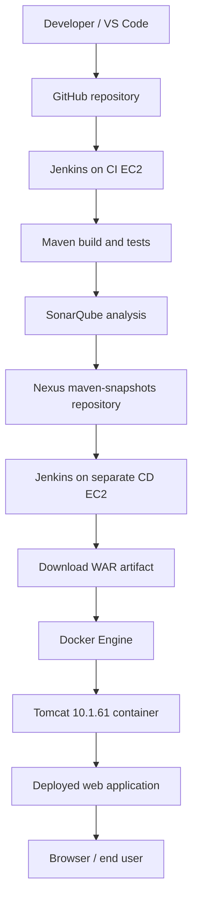
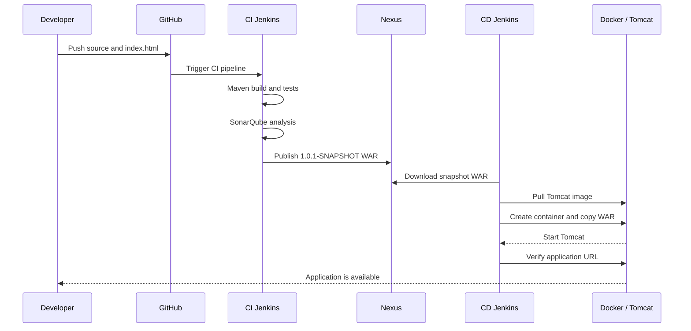

# Continuous Deployment (CD) – Docker and Tomcat on AWS EC2

## 1. Project overview

This document describes the Continuous Deployment (CD) part of the hands-on DevOps project. The CI pipeline builds and tests a Java web application, performs code-quality analysis, and publishes a Maven snapshot WAR file to Nexus. A separate CD Jenkins server downloads that WAR from Nexus and deploys it to Apache Tomcat running inside a Docker container.

The application is a Maven WAR project:

- Group ID: `com.example`
- Artifact ID: `tomcat-web-application`
- Version: `1.0.1-SNAPSHOT`
- Packaging: `war`
- Java release: `21`
- Tomcat image: `tomcat:10.1.61`

> The deployment uses the snapshot artifact `1.0.1-SNAPSHOT`. The release deployment path was not part of this confirmed CD exercise.

## 2. Architecture



### Server responsibilities

| Server | Responsibilities |
|---|---|
| CI EC2 server | CI Jenkins, Maven build, tests, SonarQube, Nexus repository |
| CD EC2 server | CD Jenkins, Docker Engine, Tomcat container, application deployment |

Nexus is hosted on the CI server in this lab. The CD Jenkins server retrieves the already-built artifact from Nexus; it does not rebuild the application.

## 3. Traffic and port flow

```text
Developer browser
      |
      | Jenkins UI: TCP 8080
      v
CD EC2 server - Jenkins
      |
      | HTTP to CI server: TCP 8081
      v
CI EC2 server - Nexus
      |
      | WAR artifact is downloaded by CD Jenkins
      v
CD EC2 server - Docker
      |
      | Host TCP 9090 -> Container TCP 8080
      v
Tomcat container -> /tomcat-web-application/
```

| Service | Server | Port | Purpose |
|---|---|---:|---|
| Jenkins CI | CI EC2 | 8080 | CI pipeline UI |
| SonarQube | CI EC2 | 9000 | Code-quality dashboard |
| Nexus | CI EC2 | 8081 | WAR artifact repository |
| Jenkins CD | CD EC2 | 8080 | CD pipeline UI |
| Tomcat | Inside Docker container | 8080 | Tomcat's listening port |
| Tomcat published port | CD EC2 host | 9090 | Browser access to the application |

The Docker mapping must be `9090:8080`, which means **host port 9090** forwards to **container port 8080**. Do not use `9090:9090` because Tomcat listens on port 8080 inside this container.

Application URL:

```text
http://<CD-SERVER-PUBLIC-IP>:9090/tomcat-web-application/
```

Replace the placeholder with the current public IP or DNS name of the CD server. Do not publish temporary server IPs, credentials, or tokens in a public blog post.

## 4. Prerequisites

### CI server

- CI pipeline is successful.
- Maven WAR snapshot is published to Nexus.
- Nexus snapshot repository is online.
- Nexus deployment account `jenkins-deploy` exists and has read access to the snapshot repository.

### CD server

- Ubuntu EC2 instance is launched and reachable over SSH.
- Java 21 is installed for Jenkins.
- Jenkins is installed, started, and reachable on TCP 8080.
- Docker Engine is installed and running.
- Jenkins Linux user can run Docker commands.
- Required Jenkins plugins are installed: Pipeline, Git, and Credentials Binding.
- CD Jenkins has a username/password credential for Nexus.

## 5. CD server preparation

### Install Docker

```bash
sudo apt update
sudo apt install docker.io -y
sudo systemctl start docker
sudo systemctl enable docker
sudo systemctl status docker
```

Allow the Jenkins Linux user to access Docker:

```bash
sudo usermod -aG docker jenkins
sudo systemctl restart jenkins
```

Verify Docker access as the Jenkins user:

```bash
sudo -u jenkins docker ps
```

The command should run without a Docker permission error. An empty container list is normal before deployment.

### Install Jenkins

Install Java 21 first, then add the official Jenkins LTS repository and install Jenkins using the current Jenkins installation instructions for Ubuntu. Start and enable the service:

```bash
sudo systemctl start jenkins
sudo systemctl enable jenkins
sudo systemctl status jenkins
```

Open the CD Jenkins UI using:

```text
http://<CD-SERVER-PUBLIC-IP>:8080
```

## 6. AWS Security Group rules

Apply least-privilege inbound rules:

| Destination server | Port | Recommended source | Reason |
|---|---:|---|---|
| CI EC2 (Nexus) | 8081 | CD server Security Group | CD Jenkins downloads the WAR |
| CD EC2 (Jenkins) | 8080 | Administrator's public IP | Jenkins administration |
| CD EC2 (Tomcat) | 9090 | Administrator's IP, or intended audience for a public demo | Application access |

Do not expose Nexus or Jenkins to `0.0.0.0/0`. For a public portfolio demonstration, opening application port 9090 to a wider audience should be a deliberate temporary decision; close it when the demo is finished. Ensure the servers can reach the required outbound repositories and package sources.

## 7. Jenkins credentials on CD

Create this credential on the **CD Jenkins server**:

| Field | Value |
|---|---|
| Kind | Username with password |
| Username | `jenkins-deploy` |
| Password | The password for the Nexus deployment account |
| ID | `nexus-credentials` |
| Description | `Nexus Deployment Credentials` |

The Jenkinsfile refers to the credential by its ID. It does not contain the password. Never place the password directly in the Jenkinsfile or publish it in GitHub.

## 8. CD Jenkins job configuration

Create a Pipeline job named:

```text
Docker-Tomcat-CD
```

Two ways to use the pipeline are available:

1. **Pipeline script:** Paste the contents of `CD-Jenkinsfile` into the job's Script box.
2. **Pipeline script from SCM:** Commit `CD-Jenkinsfile` to the Git repository, choose Git as the SCM, and set Script Path to the committed file path (for example, `docker-using-jenkins/CD-Jenkinsfile`).

If the Jenkins job currently uses an inline Pipeline script, replacing that script with the contents of this file is the quickest way to keep the working setup.

## 9. CD Jenkinsfile

The separate file `CD-Jenkinsfile` is included with this README. Its stages are:

1. **Download WAR from Nexus:** Uses the `nexus-credentials` Jenkins credential, reads Maven snapshot metadata, finds the timestamped WAR version, and downloads the WAR.
2. **Pull Tomcat Image:** Pulls `tomcat:10.1.61` from the container registry.
3. **Deploy WAR to Tomcat:** Removes the previous `tomcat-app` container, creates a new container with `9090:8080` port mapping, copies the WAR into Tomcat's `webapps` directory, and starts the container.
4. **Verify Deployment:** Tries the local application URL and fails the pipeline if the application does not respond within the retry window.

The pipeline uses a stable snapshot version in Nexus but resolves the timestamped snapshot file through `maven-metadata.xml`. This is important because Maven snapshot files are stored with timestamped build versions.

## 10. Deployment commands used by the pipeline

The key deployment operations are equivalent to:

```bash
docker pull tomcat:10.1.61

docker rm -f tomcat-app || true

docker create \
  --name tomcat-app \
  --restart unless-stopped \
  -p 9090:8080 \
  tomcat:10.1.61

docker cp deployment/application.war \
  tomcat-app:/usr/local/tomcat/webapps/tomcat-web-application.war

docker start tomcat-app
```

## 11. Verify deployment

On the CD EC2 server:

```bash
docker ps -a
```

The `tomcat-app` container should show an `Up` status and port mapping similar to:

```text
0.0.0.0:9090->8080/tcp
```

Check the application locally on the CD server:

```bash
curl -i http://localhost:9090/tomcat-web-application/
```

Then open it from a browser:

```text
http://<CD-SERVER-PUBLIC-IP>:9090/tomcat-web-application/
```

The updated project showcase page is served from the application's `src/main/webapp/index.html` file. The WAR must be rebuilt by CI and redeployed by CD whenever this page changes.

## 12. Troubleshooting encountered during the lab

### A. Host port 8080 already in use

**Error:** `failed to bind host port ... 8080 ... address already in use`

**Reason:** Jenkins on the CD EC2 server already uses host port 8080.

**Fix:** Publish Tomcat on host port 9090 and keep Tomcat's internal port at 8080:

```bash
-p 9090:8080
```

### B. Incorrect Docker port mapping

**Incorrect:** `9090:9090`

**Correct:** `9090:8080`

Tomcat listens on 8080 inside the container. The host port can be 9090.

### C. Browser reports connection refused

Check these items in order:

```bash
docker ps -a
docker logs --tail 100 tomcat-app
curl -i http://localhost:9090/tomcat-web-application/
```

Then confirm the CD EC2 Security Group permits inbound TCP 9090 from the intended client source. Confirm that the container port mapping is `9090->8080`.

### D. Browser shows unexpected text instead of the page

Inspect the deployed HTML file:

```bash
docker exec tomcat-app cat \
  /usr/local/tomcat/webapps/tomcat-web-application/index.html
```

The lab exposed an incorrect `index.html` containing POM XML instead of HTML. The source file was corrected in:

```text
tomcat-web-application/src/main/webapp/index.html
```

After changing source code, run CI again to publish a fresh WAR, then run CD again to deploy it.

### E. Nexus download fails

Check:

- The CI server's Nexus service is running on port 8081.
- The Nexus Security Group permits TCP 8081 from the CD server Security Group.
- The CD Jenkins credential ID is exactly `nexus-credentials`.
- The account can read `maven-snapshots`.
- The artifact path and version match the snapshot published by CI.

## 13. End-to-end execution flow



## 14. Completion summary

The CD lab demonstrates a separate deployment server and an automated delivery path from Nexus to a Tomcat container:

- CD Jenkins runs on a separate AWS EC2 instance.
- Jenkins uses a stored Nexus credential rather than a hard-coded password.
- The WAR is downloaded from the Nexus snapshot repository.
- Docker runs Apache Tomcat `10.1.61`.
- The WAR is copied to Tomcat's `webapps` directory.
- Host port 9090 forwards to container port 8080.
- The pipeline performs an HTTP verification after deployment.

This is a learning/lab deployment. For production, improve it with a private network path to Nexus, TLS, managed secrets, health checks, rollback, immutable release versions, and a deployment strategy that avoids removing the currently running application before the new one is verified.
